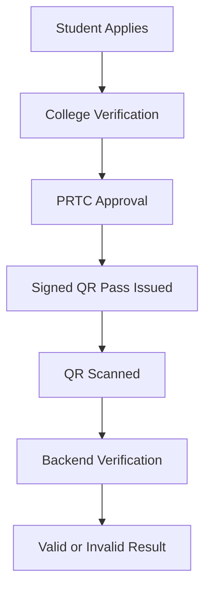

<div align="center">

# 🚌 SafrSaathi

**Digital Student Concession Pass Platform**

Apply online. Get verified. Travel with a digitally signed QR pass.

**React · TypeScript · FastAPI · SQLAlchemy · JWT**

[Live Demo](https://safrsaathi.vercel.app) · [Repository](https://github.com/ParteekMarve/SafrSaathi)

</div>

---

## 📌 About

SafrSaathi digitizes the student concession-pass process for Punjab's public transport system. Students apply online, college administrators verify applications, and PRTC administrators sanction passes. Approved students receive a signed QR pass that can be verified by authorized personnel.

## ✨ Key Features

* **Student Portal:** Apply for passes and track approval status.
* **College Admin:** Review and approve student applications.
* **PRTC Admin:** Sanction passes and verify QR codes.
* **QR Verification:** Signed, expiring tokens validated by the backend.
* **Role-Based Access:** Permissions enforced by the backend.
* **Additional Portals:** Passenger and corporate features in the prototype.

## 🏗️ How It Works



## 🛠️ Tech Stack

| Layer          | Technology                                |
| -------------- | ----------------------------------------- |
| Frontend       | React, TypeScript, Vite, Tailwind CSS     |
| Backend        | Python, FastAPI, SQLAlchemy               |
| Authentication | JWT, PBKDF2; Google sign-in prepared      |
| QR Codes       | `qrcode`, `html5-qrcode`                  |
| Database       | SQLite locally, PostgreSQL for production |
| Hosting        | Vercel, Render; hosted PostgreSQL         |

## 🚀 Run Locally

**Requirements:** Python 3.10+ and Node.js 18+.

### Backend

```powershell
cd backend
python -m venv .venv
.\.venv\Scripts\Activate.ps1
pip install -r requirements.txt
Copy-Item .env.example .env
uvicorn app.main:app --reload --port 8000
```

Configure `JWT_SECRET` and `DATABASE_URL` in `.env` before running.

API docs: `http://localhost:8000/docs`

### Frontend

Open another terminal:

```powershell
cd Frontend
npm install
Copy-Item .env.example .env.local
npm run dev
```

Set `VITE_API_URL` to the backend API URL, then open the address printed by Vite.

## 🔐 Security

* Passwords are hashed using PBKDF2.
* Protected endpoints use JWT authentication.
* Role and college restrictions are enforced on the backend.
* QR passes use signed tokens with expiry validation.
* Aadhaar numbers are masked in the student interface.

**Before production:** Configure Google OAuth, private document storage, HTTPS, rate limiting, and a real SMS OTP provider.

## ⚠️ Limitations

* Signup OTP and payment screens are demo features.
* Private document storage is not yet connected.
* A separate conductor role and signed journey-ticket QR codes are planned.
* Google sign-in requires OAuth configuration.

## 🗺️ Roadmap

* Dedicated conductor portal and offline verification.
* Private document storage and renewal reminders.
* Signed journey-ticket QR codes.
* Corporate passes and administrative analytics.

## 👥 Team

* [Piyush Chhibber](https://github.com/piyushchhibber)
* [Parteek Marve](https://github.com/ParteekMarve)

## 📄 License

No license has been selected yet.
